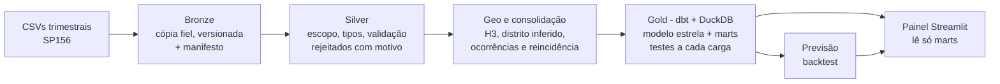
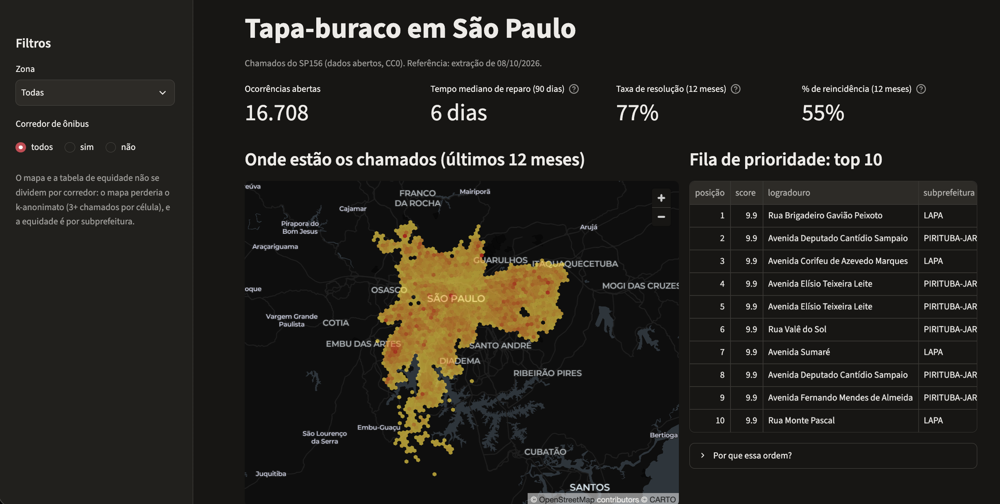

# Reparos urbanos: tapa-buraco em São Paulo

São Paulo recebe dezenas de milhares de pedidos de tapa-buraco por trimestre pelo SP156, mas um
pedido não é um buraco: o mesmo problema gera várias reclamações, e o mesmo ponto volta a quebrar
depois do conserto. Os dados abertos da prefeitura mudam de formato sem aviso e são republicados
depois de fechados, o que torna arriscado contar direto do arquivo. Este projeto transforma os
pedidos em **problemas físicos**, mede quanto eles demoram e voltam, e monta uma **fila de
prioridade** e um painel a partir disso.



## Decisões de projeto

**Partição por trimestre, com versões.** O portal publica um arquivo por trimestre e o substitui
inteiro quando atualiza. A bronze guarda cada arquivo como veio, em
`trimestre=AAAATn/versao=<timestamp UTC>`, e a versão vigente é a mais recente: uma republicação
vira uma versão nova, nunca sobrescreve a anterior. Um arquivo idêntico a uma versão *antiga* é
recusado, para a pipeline não voltar no tempo.

**O formato é detectado, não suposto.** O trimestre sai das datas do próprio arquivo. Para cada
arquivo, a ingestão testa `dd/mm` e `mm/dd` e fica com o único formato que produz datas válidas e um
só trimestre; se os dois servirem, ela recusa por ambiguidade em vez de adivinhar. Codificação e
separador também são detectados e gravados no manifesto.

**O manifesto é o marcador de commit.** Na bronze, a versão é escrita numa pasta temporária e só
recebe o nome definitivo depois de completa. Na silver, os dois Parquet são trocados primeiro e o
`_manifest.json` é gravado por último, com as contagens e as versões da bronze usadas: quem lê
recusa uma silver sem manifesto ou com contagens diferentes, porque isso indica uma geração
interrompida.

**H3 para achar vizinhos, distância para decidir, e 80 m medidos com grupo de controle.** A busca
de chamados próximos usa as células H3 (r10) vizinhas para limitar os candidatos e a distância real
para decidir. O limite de 80 m não foi escolhido: comparei a distância ao vizinho mais próximo na
mesma rua em ±7 dias com a de chamados abertos 90 e 180 dias depois (mesma rua, quase sempre outro
buraco). Até 80 m, a janela de 7 dias tem mais que o dobro de vizinhos do controle; perto de 200 m
o excesso some.

**Distrito inferido por votação, validada antes de usar.** Os 196 chamados sem distrito recebem o
distrito mais comum entre os vizinhos na mesma célula H3 (r10, depois as células ao redor, depois
r8). Numa amostra de 5.000 chamados *com* distrito, tirados dos eleitores, a votação acertou
**97,3%**, e 98,9% quando o vencedor tem pelo menos 80% dos votos.

**Ocorrência = componente conexo.** Dois chamados são do mesmo problema se estão na mesma rua, a
até 80 m, e foram abertos com até 7 dias de diferença ou antes de o mais antigo ser finalizado;
nenhuma ligação passa de 365 dias. As ligações formam um grafo, e cada componente conexo é uma
ocorrência (A–B e B–C juntam A, B e C), com um id determinístico. Uma ocorrência que surge no mesmo
ponto depois de outra resolvida é uma **reincidência**.

## Achados

**O formato muda sem aviso.** Oito trimestres vêm em `dd/mm/aaaa`, Latin-1 e ponto e vírgula; o
2026T3 chegou em `mm/dd/aaaa`, UTF-8 com BOM e vírgula. Lido com o formato dos outros, 62% das
datas do 2026T3 ficam inválidas e o resto sai com dia e mês trocados, sem nenhum erro.

**O 2025T1 passou pelo Excel.** O arquivo tem exatamente 1.048.575 linhas de dados, o limite de uma
planilha, e 305.671 delas estão vazias: são 742.904 chamados reais e o resto é enchimento.

**Trimestres fechados são republicados.** O arquivo do 2024T3, cujo último chamado é de
30/09/2024, traz finalizações até 10/08/2026. Os oito arquivos de 2024T3 a 2026T2 têm finalizações
de 5 a 10/08/2026: foram regenerados juntos, o que bate com o "atualizado em 10/08/2026" do
glossário. O status de um chamado antigo muda depois de publicado.

**Metade dos chamados é repetição.** 49,6% dos chamados (121.316) têm outro chamado na mesma rua, a
até 80 m e em ±7 dias, e 30.118 são gêmeos exatos (mesmo ponto, mesmo dia, mesma rua). Os 244.426
chamados válidos viram **129.449 ocorrências**, 1,9 chamados por problema.

**A rajada da Rua Anoriaçu.** Um único problema reuniu **361 chamados**: dois focos a 72 m um do
outro, 96% pelo aplicativo, em rajadas de 70 a 122 por mês, com 189 ainda abertos. Contar
chamados aqui superestimaria o problema em mais de 300 vezes.

**O buraco volta.** **45% das ocorrências** (58.451) surgem no mesmo ponto de um problema já
encerrado; 17.512 voltaram três vezes ou mais, e o recorde é 23. No corredor de ônibus, 69% das
ocorrências dos últimos 12 meses são reincidências, contra 55% no resto da cidade, e os reparos
dos últimos 90 dias levaram 14 dias de mediana, contra 6.

## Como rodar

Requer Python 3.12, o [uv](https://docs.astral.sh/uv/) e os CSVs trimestrais do SP156 em
`data/raw/` (ver [data/README.md](data/README.md)).

```bash
uv venv --python 3.12 .venv && uv pip install -r requirements.txt
make pipeline     # bronze -> silver -> gold (dbt) -> previsão, ~1 min
make painel       # http://localhost:8501
```

`make testes` roda o pytest e os testes de dados do dbt. No GitHub Actions, sem os dados, os testes
sintéticos rodam e os de dados reais são pulados.



## Limitações

- **A data de extração é estimada.** O arquivo não diz quando foi gerado; `data_extracao` é a
  maior data de abertura ou finalização presente nele, um limite inferior da data real.
- **"Fora do município" usa um retângulo**, não o contorno da cidade: pontos de cidades vizinhas
  dentro do retângulo passam pela validação.
- **33 chamados ficam sem distrito.** Nenhum vizinho com distrito na célula nem ao redor; quase
  todos são coordenadas em cidades vizinhas com logradouro de São Paulo (erro de geocodificação).
  Continuam válidos, com `flag_sem_votos`.
- **10 distritos inferidos estão na divisa**, com o vencedor abaixo de 80% dos votos. Entram com
  a melhor estimativa e `flag_distrito_divisa`.
- **"Mesma rua" depende da grafia.** Esquinas e rodovias com dois nomes contam como ruas
  diferentes: 2,2% dos pares a menos de 20 m, o que deixa 2.630 chamados (1,1%) sem a marca de
  repetição.
- **Não há dado de severidade.** O arquivo não diz o tamanho nem o risco do buraco; a fila usa
  aproximações (tempo de espera, tipo de via, número de chamados, reincidência). "Finalizado" no
  SP156 também não garante conserto: a reincidência mede volta depois do encerramento do chamado.

Detalhes do modelo estrela, do score de prioridade, da previsão e das medições:
[docs/referencia_tecnica.md](docs/referencia_tecnica.md).
