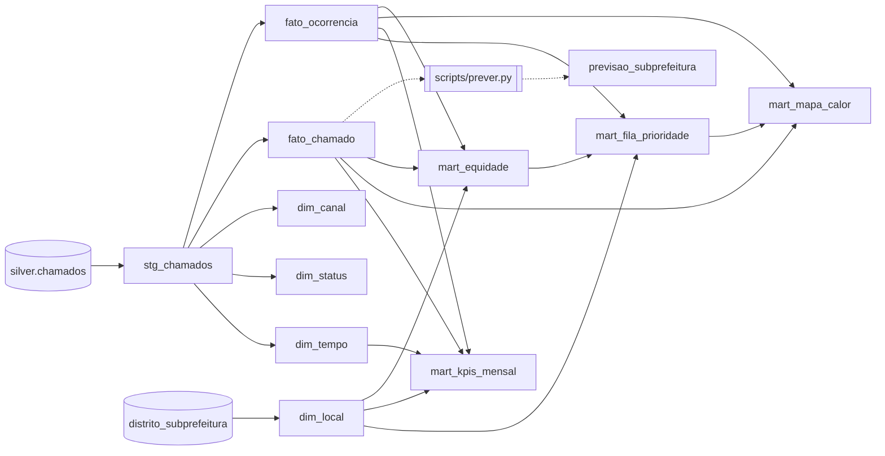

# Reparos urbanos

Pipeline de dados sobre os chamados de tapa-buraco abertos no SP156, o canal de atendimento da
Prefeitura de São Paulo. Os dados vêm do portal de dados abertos da prefeitura (licença CC0) e
passam por três camadas:

- **Bronze** (`src/ingestao.py`): cópia fiel de cada arquivo trimestral, versionada e com manifesto.
- **Silver** (`src/silver.py`, `src/geo.py`): só os chamados de tapa-buraco, com tipos corrigidos,
  validação (rejeitados vão para uma tabela própria, com o motivo), subprefeitura e zona por uma
  tabela de referência, enriquecimento geográfico com H3 (distrito inferido, repetições) e
  consolidação em ocorrências (`src/consolidacao.py`).
- **Gold** (`dbt_reparos/`): modelo estrela num arquivo DuckDB (`data/gold/reparos.duckdb`),
  construído pelo dbt a partir da silver, com testes de dados a cada carga.

## Como rodar

Requer Python 3.12 (`.python-version`) e o [uv](https://docs.astral.sh/uv/).

```bash
uv venv --python 3.12 .venv
source .venv/bin/activate
uv pip install -r requirements.txt

# Coloque os CSVs trimestrais em data/raw/ (ver data/README.md)
python -m scripts.ingerir_todos    # bronze
python -m scripts.gerar_silver     # silver: data/silver/chamados.parquet e rejeitados.parquet
pytest -q                          # sem bronze, os testes de dados reais são pulados

# Gold (o DuckDB não cria a pasta do banco). O dbt roda de dentro de dbt_reparos/,
# porque os caminhos do profile e da fonte são relativos a ela.
mkdir -p data/gold
cd dbt_reparos
dbt seed --profiles-dir .
dbt build --profiles-dir .         # modelos + testes de dados
cd .. && python -m scripts.prever  # backtest e previsão (grava em marts; rodar depois do dbt build)
cd dbt_reparos
dbt docs generate --profiles-dir . && dbt docs serve --profiles-dir .
```

## Gold: modelo estrela

| Tabela | Grão | Conteúdo |
|---|---|---|
| `core.fato_chamado` | 1 chamado | chaves das dimensões, `id_ocorrencia`, `tempo_resolucao_dias`, flags, `celula_r8` e coordenadas com 3 casas |
| `core.fato_ocorrencia` | 1 problema físico | início, fim, situação, chamados, reincidência, extensão, `dias_em_aberto` |
| `core.dim_tempo` | 1 dia | ano, mês, trimestre, dia da semana, `flag_periodo_chuvoso` (dezembro a março) |
| `core.dim_local` | 1 distrito | subprefeitura e zona (seed, cópia de `src/referencias/`) |
| `core.dim_status`, `core.dim_canal` | 1 valor | valores distintos da staging |

A gold não guarda coordenada exata nem a célula r10: só lat/lon com 3 casas (~110 m) e a célula
r8. O teste `assert_sem_dado_pessoal` falha se surgir em core ou marts uma coluna com nome de dado
pessoal (número, CEP, protocolo, CPF, e-mail, telefone).

### Marts

| Tabela | Conteúdo |
|---|---|
| `marts.mart_fila_prioridade` | ocorrências abertas com os 5 componentes, o `score` (0 a 10), `posicao_fila` e `flag_verificar_em_campo` (abertas há mais de 180 dias) |
| `marts.mart_kpis_mensal` | por mês de abertura e zona: chamados, ocorrências, taxa de resolução, tempo mediano de reparo, % de reincidência |
| `marts.mart_mapa_calor` | por célula H3 r8, últimos 12 meses, só células com 3 ou mais chamados (k-anonimato) |
| `marts.mart_equidade` | por subprefeitura: % de canais digitais, tempo de reparo (mediana e p90), % de abertas há mais de 90 dias |
| `marts.previsao_subprefeitura` | chamados previstos por subprefeitura nos 3 meses seguintes (`scripts/prever.py`) |
| `marts.previsao_backtest` | previsto × real de 07 a 09/2026, treinando até 06/2026 |

**Score de prioridade** = 10 × soma ponderada de 5 componentes entre 0 e 1. Pesos e tetos ficam em
`vars` no `dbt_project.yml`, e um teste falha se os pesos não somarem 1.

| Componente | Peso | Fórmula |
|---|---|---|
| espera | 0,30 | `dias_em_aberto / 30`, limitado a 1 |
| via | 0,25 | corredor de ônibus 1,0 · avenida, estrada, viaduto ou ponte 0,7 · demais 0,4 |
| demanda | 0,15 | `ln(1 + qtd_chamados) / ln(11)`, limitado a 1 |
| reincidência | 0,15 | `numero_reincidencia / 3`, limitado a 1 |
| equidade | 0,15 | `percent_rank` da mediana de tempo de reparo da subprefeitura; sem subprefeitura, 0,5 |

Como ler:

- **A espera quase não diferencia as abertas.** 89% delas (14.881 de 16.708) têm 30 dias ou
  mais e recebem o componente máximo; na prática a espera soma 3 pontos a quase todas, e a ordem
  vem dos outros componentes.
- **O topo tem empates.** O score máximo possível é 9,90, e não 10, porque a equidade é um
  `percent_rank` e as 3 subprefeituras mais lentas empatam em 0,935. 19 ocorrências empatam em
  9,90; entre elas, a mais antiga vem primeiro.
- **O topo ainda é, em boa parte, passivo antigo.** 17 das 19 primeiras têm
  `flag_verificar_em_campo` (46% das abertas passam de 180 dias); a primeira sem a flag está na
  posição 18. Antes de despachar pelo topo, a equipe confirma o status em campo.
- **% de reincidência cresce com o tempo por construção.** Uma reincidência precisa de uma
  ocorrência anterior dentro dos dados, que começam em 07/2024. Nos primeiros meses quase nada
  pode ser reincidência (3,7% em 07/2024 na zona Leste, contra mais de 50% em 2025): a subida é
  artefato da janela, não piora real.
- **A taxa de resolução dos meses recentes ainda vai subir**: parte das ocorrências abertas há
  pouco não teve tempo de ser resolvida. Os meses de 07 a 09/2024 também aparecem baixos, por
  causa dos status desatualizados do 2024T3.

**Previsão.** O baseline sazonal (mesmo mês do ano anterior × nível dos 3 últimos meses contra os
mesmos meses um ano antes) **errou mais que a referência ingênua** (repetir o último mês): erro
médio absoluto de 144 contra 109 chamados por subprefeitura e mês, treinando até 06/2026. Repetido
em todas as origens possíveis (09/2025 a 06/2026), o sazonal vence em 1 de 10 (média de 112 contra
90). Com só dois anos de dados, o ano anterior ainda é um guia fraco, e a razão de nível amplifica
oscilações curtas. Por isso `scripts/prever.py` grava a previsão do método que errou menos no
backtest, hoje o ingênuo.

Linhagem (extraída do `manifest.json` do dbt; o print do `dbt docs serve` fica em
`docs/linhagem_dbt.png`):



Duas observações de uso:

- `staging.stg_chamados` é uma view que lê `../data/silver/` por caminho relativo: ela só abre com o
  banco aberto de dentro de `dbt_reparos/`. As tabelas de `core` são materializadas e abrem de
  qualquer lugar.
- O seed é uma cópia da referência da silver; um teste do pytest falha se as duas divergirem.

## Limitações

**"Mesma rua" depende do nome do logradouro.** A `flag_repeticao` marca outro chamado na mesma
rua, a até 80 m e aberto em ±7 dias. A comparação é pelo nome normalizado (sem acento nem
diferença de maiúsculas), então esquinas e rodovias com dois nomes contam como ruas diferentes,
por exemplo Rua dos Piemonteses × Rua Agostinho de Azevedo e Estrada do M'Boi Mirim × SP-214.

Medido nos 244.426 chamados válidos (`python -m scripts.medir_limitacao_rua`):

| | Pares |
|---|---|
| Pares a menos de 20 m em ±7 dias | 287.578 |
| na mesma rua | 281.381 |
| **em ruas diferentes** | **6.197 (2,2%)** |

Por causa disso, **2.630 chamados (1,1%)** ficam sem `flag_repeticao`, embora tenham um vizinho a
menos de 20 m numa rua de outro nome. Expandir abreviações não resolveria: os logradouros já vêm
por extenso, e isso recuperaria só 4 chamados.

**"Fora do município" usa um retângulo, não o contorno da cidade.** Pontos de cidades vizinhas que
caem dentro do retângulo passam pela validação. Os 33 chamados com `flag_sem_votos` (nenhum
chamado com distrito na mesma célula H3 nem nas vizinhas) são, na maioria, coordenadas em
cidades vizinhas com logradouro de São Paulo, ou seja, erros de geocodificação. Eles continuam
válidos, com a flag.

**A data de extração é estimada.** O arquivo não informa quando foi gerado; `data_extracao` é a
maior data de abertura ou finalização presente nele, um limite inferior da data real.

## Casos verificados

### Rua Anoriaçu (consolidação em ocorrências)

Teste de mesa da regra de ligação (`src/consolidacao.py`): a previsão foi escrita antes de rodar,
sobre a caixa lat −23,4610 a −23,4590 e lon −46,5725 a −46,5705.

| | Previsão | Resultado |
|---|---|---|
| Ocorrências na caixa | 3 a 6, quase todas na Rua Anoriaçu | **13**, em 4 ruas (427 chamados) |
| Ocorrências grandes | 1 ou 2, com dezenas de chamados | **1 com 361 chamados** (189 abertos), mais 33, 12 e 11 |
| Extensão da maior | abaixo de 100 m | **164 m** |
| Reincidência máxima | 1 a 3 | **4** |

O que a previsão não antecipou: a maior ocorrência junta 4 pontos da mesma rua, dois deles com
214 e 132 chamados (96% pelo aplicativo, em rajadas de 70 a 122 por mês) a cerca de 72 m um do
outro. Eles se ligam diretamente, e dois pontos menores ao sul entram em cadeia, por isso a
extensão passa do limite de 80 m. É o efeito da regra (b): enquanto há chamado aberto no ponto,
toda reclamação nova a até 80 m na mesma rua entra na mesma ocorrência. Se os dois focos são o
mesmo trecho estragado ou dois buracos vizinhos, os dados não dizem.

Na cidade toda, o encadeamento é limitado: o p99 da extensão por ocorrência é 166 m (242 m entre
as ocorrências com 2 ou mais chamados), abaixo do corte de 300 m combinado para criar a
`flag_ocorrencia_extensa`. A cauda existe (160 ocorrências passam de 300 m, somando 4.966
chamados), e as cinco maiores estão todas abertas.
