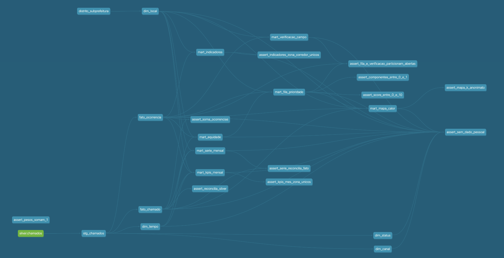
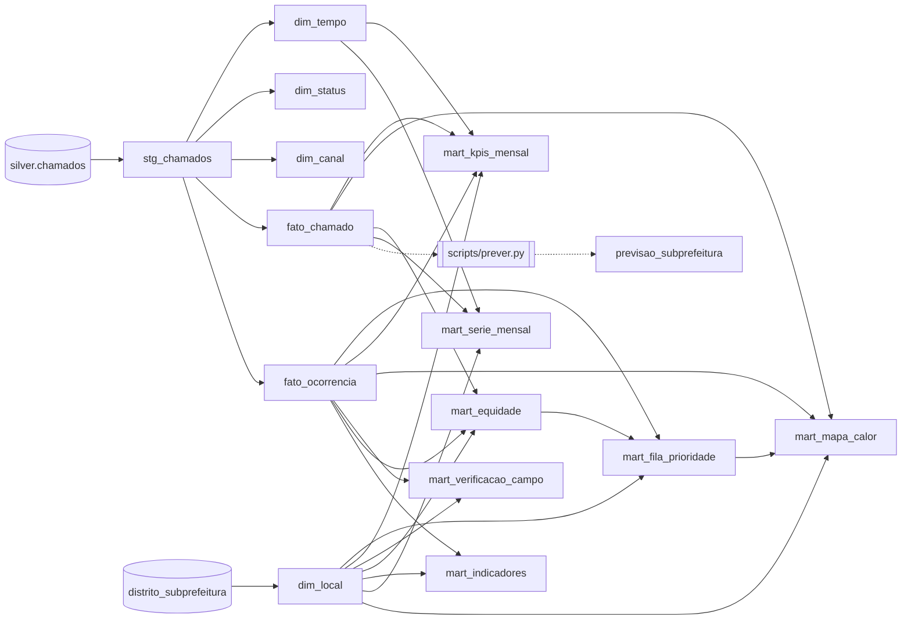

# Referência técnica

Detalhes que sustentam o README: o modelo estrela, o score de prioridade, a previsão, a linhagem e as medições.

## Gold: modelo estrela

| Tabela | Grão | Conteúdo |
|---|---|---|
| `core.fato_chamado` | 1 chamado | chaves das dimensões, `id_ocorrencia`, `tempo_resolucao_dias`, flags, `celula_r8` e coordenadas com 3 casas |
| `core.fato_ocorrencia` | 1 problema físico | início, fim, situação, chamados, reincidência, extensão, `dias_em_aberto` |
| `core.dim_tempo` | 1 dia | ano, mês, trimestre, dia da semana, `flag_periodo_chuvoso` (dezembro a março) |
| `core.dim_local` | 1 distrito | subprefeitura e zona (seed, cópia de `src/referencias/`) |
| `core.dim_status`, `core.dim_canal` | 1 valor | valores distintos da staging |

A gold não guarda coordenada exata nem a célula r10: só lat/lon com 3 casas (~110 m) e a célula
r8. O teste `assert_sem_dado_pessoal` falha se surgir em core ou marts uma coluna com nome de dado
pessoal (número, CEP, protocolo, CPF, e-mail, telefone).

## Marts

| Tabela | Conteúdo |
|---|---|
| `marts.mart_fila_prioridade` | abertas há até 180 dias, com os 5 componentes, o `score` (0 a 10) e `posicao_fila` |
| `marts.mart_verificacao_campo` | abertas há mais de 180 dias, das mais antigas para as mais novas: confirmar se ainda existem antes de despachar |
| `marts.mart_kpis_mensal` | por mês de abertura e zona: chamados, ocorrências, taxa de resolução, tempo mediano de reparo, % de reincidência |
| `marts.mart_mapa_calor` | por célula H3 r8, últimos 12 meses, só células com 3 ou mais chamados (k-anonimato) |
| `marts.mart_equidade` | por subprefeitura: % de canais digitais, tempo de reparo (mediana e p90), % de abertas há mais de 90 dias |
| `marts.mart_indicadores` | os 4 indicadores do painel para cada combinação de zona e corredor, com os totais (`group by cube`); taxa de resolução e reincidência sobre as ocorrências iniciadas de 15 a 3 meses antes da extração |
| `marts.mart_serie_mensal` | chamados por mês, zona e corredor (contagens que se somam, para os filtros do painel) |
| `marts.previsao_subprefeitura` | chamados previstos por subprefeitura nos 3 meses seguintes (`scripts/prever.py`) |
| `marts.previsao_backtest` | previsto × real de 07 a 09/2026, treinando até 06/2026 |

**Score de prioridade** = 10 × soma ponderada de 5 componentes entre 0 e 1. Pesos e tetos ficam em
`vars` no `dbt_project.yml`, e um teste falha se os pesos não somarem 1.

| Componente | Peso | Fórmula |
|---|---|---|
| espera | 0,30 | `dias_em_aberto / 180` (a fila só tem até 180 dias) |
| via | 0,25 | corredor de ônibus 1,0 · avenida, estrada, viaduto ou ponte 0,7 · demais 0,4 |
| demanda | 0,15 | `ln(1 + qtd_chamados) / ln(11)`, limitado a 1 |
| reincidência | 0,15 | `numero_reincidencia / 3`, limitado a 1 |
| equidade | 0,15 | `percent_rank` da mediana de tempo de reparo da subprefeitura; sem subprefeitura, 0,5 |

Como ler:

- **Duas listas.** Das 16.708 abertas, 8.980 estão na fila e 7.728 (46%) na verificação em campo.
  Antes da separação, com teto de espera de 30 dias, 89% das abertas tinham a espera no máximo e
  17 das 19 primeiras posições eram passivo antigo.
- **A espera voltou a diferenciar.** Com teto de 180 dias, só 0,3% da fila tem o componente em 1, e
  o topo não tem empates (9,66, 9,62, 9,47).
- **A via passou a dominar o topo.** 17 das 20 primeiras posições estão em corredor de ônibus, que
  é só 3,8% da fila: o corredor vale 1,0 contra 0,7 de uma avenida (0,75 ponto de score).
- **A reincidência do score está inflada pela densidade de chamados.** Pelo grupo de controle
  (0–80 m contra 80–160 m), só cerca de 10 dos 45 pontos percentuais são atribuíveis ao mesmo
  ponto. O componente herda essa inflação; com peso de 15% é aceitável, mas favorece ruas com
  muitos chamados.
- **% de reincidência cresce com o tempo por construção.** Uma reincidência precisa de uma
  ocorrência anterior dentro dos dados, que começam em 07/2024. Nos primeiros meses quase nada
  pode ser reincidência (3,7% em 07/2024 na zona Leste, contra mais de 50% em 2025): a subida é
  artefato da janela, não piora real.
- **A taxa de resolução dos meses recentes ainda vai subir**: parte das ocorrências abertas há
  pouco não teve tempo de ser resolvida. Os meses de 07 a 09/2024 também aparecem baixos, por
  causa dos status desatualizados do 2024T3.

**Previsão.** O baseline sazonal (mesmo mês do ano anterior × nível dos 3 últimos meses contra os
mesmos meses um ano antes) **errou mais que a referência ingênua** (repetir o último mês): erro
médio absoluto de 144 contra 109 chamados por subprefeitura e mês, treinando até 06/2026. Repetido
em todas as origens possíveis (09/2025 a 06/2026), o sazonal vence em 1 de 10 (média de 112 contra
90). Com só dois anos de dados, o ano anterior ainda é um guia fraco, e a razão de nível amplifica
oscilações curtas. Por isso `scripts/prever.py` grava a previsão do método que errou menos no
backtest, hoje o ingênuo.

Linhagem (extraída do `manifest.json` do dbt; o print do `dbt docs serve` fica em
abaixo):

A mesma linhagem em Mermaid, incluindo o seed e a `dim_local`:

Duas observações de uso:

- `staging.stg_chamados` é uma view que lê `../data/silver/` por caminho relativo: ela só abre com o
  banco aberto de dentro de `dbt_reparos/`. As tabelas de `core` são materializadas e abrem de
  qualquer lugar.
- O seed é uma cópia da referência da silver; um teste do pytest falha se as duas divergirem.

## Medição da limitação "mesma rua"

Medido nos 244.426 chamados válidos (`python -m scripts.medir_limitacao_rua`):

| | Pares |
|---|---|
| Pares a menos de 20 m em ±7 dias | 287.578 |
| na mesma rua | 281.381 |
| **em ruas diferentes** | **6.197 (2,2%)** |

Por causa disso, **2.630 chamados (1,1%)** ficam sem `flag_repeticao`, embora tenham um vizinho a
menos de 20 m numa rua de outro nome. Expandir abreviações não resolveria: os logradouros já vêm
por extenso, e isso recuperaria só 4 chamados.

## Casos verificados

### Rua Anoriaçu (consolidação em ocorrências)

Teste de mesa da regra de ligação (`src/consolidacao.py`): a previsão foi escrita antes de rodar,
sobre a caixa lat −23,4610 a −23,4590 e lon −46,5725 a −46,5705.

| | Previsão | Resultado |
|---|---|---|
| Ocorrências na caixa | 3 a 6, quase todas na Rua Anoriaçu | **13**, em 4 ruas (427 chamados) |
| Ocorrências grandes | 1 ou 2, com dezenas de chamados | **1 com 361 chamados** (189 abertos), mais 33, 12 e 11 |
| Extensão da maior | abaixo de 100 m | **164 m** |
| Reincidência máxima | 1 a 3 | **4** |

O que a previsão não antecipou: a maior ocorrência junta 4 pontos da mesma rua, dois deles com
214 e 132 chamados (96% pelo aplicativo, em rajadas de 70 a 122 por mês) a cerca de 72 m um do
outro. Eles se ligam diretamente, e dois pontos menores ao sul entram em cadeia, por isso a
extensão passa do limite de 80 m. É o efeito da regra (b): enquanto há chamado aberto no ponto,
toda reclamação nova a até 80 m na mesma rua entra na mesma ocorrência. Se os dois focos são o
mesmo trecho estragado ou dois buracos vizinhos, os dados não dizem.

Na cidade toda, o encadeamento é limitado: o p99 da extensão por ocorrência é 166 m (242 m entre
as ocorrências com 2 ou mais chamados), abaixo do corte de 300 m combinado para criar a
`flag_ocorrencia_extensa`. A cauda existe (160 ocorrências passam de 300 m, somando 4.966
chamados), e as cinco maiores estão todas abertas.
